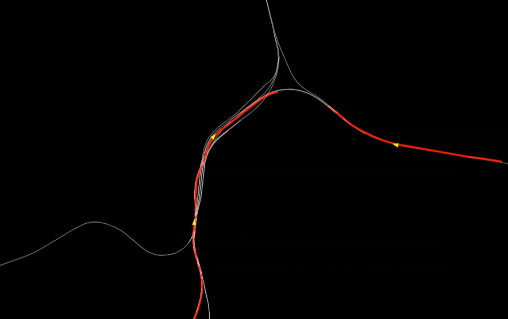

# The MATSim Switzerland Railway Scenario





----

### About this project

This repository provides a MATSim model for Switzerland's railway developed by Swiss Federal Railways (Schweizerische Bundesbahnen, SBB), Corporate Development.
The railway model is generated from GTFS train schedule data and OSM-based railway infrastructure (see `src/main/java/ch/sbb/prepare`).
The simulation then makes use of the MATSim/railsim contrib which accounts for train-specific dynamics (for more information about railsim, see https://github.com/matsim-org/matsim-libs/tree/master/contribs/railsim).

The question the model answers is whether the **published timetable can actually be driven** on the
modelled infrastructure: every train must reach its last stop, and every train must be **on time at
every stop** — on time meaning `actual arrival − published arrival = 0 s`, so an early train is as
wrong as a late one.  Two cases are simulated, each over a whole service day:

| case | departures | routes | scheduled stop arrivals |
|---|---:|---:|---:|
| **Olten** — every IC/IR/EC/RE/ICE train that touches the Olten area, each over its whole route across Switzerland | 612 | 361 | 5 459 |
| **Switzerland** — the filtered national long-distance timetable | 2 541 | 1 231 | 21 243 |

The chain is reproducible with two commands per case (`scripts/prepare_case.sh`,
`scripts/run_case.sh`); `docs/pipeline.md` describes every step, its inputs, outputs and run time, and
`docs/assumptions.md` lists every modelling assumption with what / where / why / how many trains.

Developers/Contributors: Merlin Unterfinger, Thomas Hettinger, Ihab Kaddoura

<a rel="SBB" href="www.sbb.ch"></a>

### Licenses

The **MATSim program code** in this repository is distributed under the terms of the [GNU Affero General Public License v3.0](https://www.gnu.org/licenses/agpl-3.0.html.en). The MATSim program code are files that reside in the `src` directory hierarchy and typically end with `*.java`.

The **MATSim input files, output files, analysis data and visualizations** are licensed under a <a rel="license" href="http://creativecommons.org/licenses/by/4.0/">Creative Commons Attribution 4.0 International License</a>.
<a rel="license" href="http://creativecommons.org/licenses/by/4.0/"></a><br /> MATSim input files are those that are used as input to run MATSim. They often, but not always, have a header pointing to matsim.org. They typically reside in the `matsim_input` or `scenarios` directory hierarchy. MATSim output files, analysis data, and visualizations are files generated by MATSim runs, or by postprocessing.  They typically reside in a directory hierarchy starting with `output`.

**Other data files**, in particular in `original_data`, have their own individual licenses that need to be individually clarified with the copyright holders.


----

### Prepare the input files

##### Step 1: Get the required original data

1. Download the GTFS file, e.g., from https://opentransportdata.swiss/en/group/timetables-gtfs.
1. Download the OSM file, e.g., from https://download.geofabrik.de/europe/switzerland.html.
1. (Optional) Process the OSM data, e.g., with osmosis. Download osmosis from https://wiki.openstreetmap.org/wiki/Osmosis. Filter the OSM data, e.g. with the following command: `osmosis --rb file=switzerland-latest.osm.pbf --tf accept-ways railway=* --used-node --wx switzerland_railways.osm`
1. Put the GTFS file (`*.zip`), the (processed) OSM extract (`*.osm`) and the full extract (`*.osm.pbf`,
   for the `route=train` relations) into `original_data/`.

##### Step 2: One command per case

```bash
scripts/prepare_case.sh olten          # or: scripts/prepare_case.sh switzerland
```

This runs, from the original data to a routed case (≈ 16 min for Olten, ≈ 35 min for Switzerland):

1. `ch.sbb.prepare.GenerateRailsimInput` (pt2matsim): GTFS + OSM → unmapped schedule and raw
   network in `matsim_input/tmp/` (already part of the input data; ~1 h if re-run);
2. `prepare/build_tables.py`: the static tables the router and the run class consume (running
   direction, platform tracks, legal turns, blocks, OSM relations, rolling stock, off-model track) —
   every table is rebuilt from the original data, hand-made inputs are reviewed CSVs in
   `prepare/corrections/`;
3. the rolling-stock table (`prepare/corrections/rolling_stock.csv` → `vehicles_fs1.csv`);
4. `mvn -o clean package`;
5. `ch.sbb.prepare.router.TrackRouter`: the track assignment (passing loops, Gotthard corridor rule,
   off-model track for metre gauge/abroad);
6. `prepare/fix_reversals.py`: honest reversal geometry (only `<route>` link lists change);
7. `prepare/restore_dwell.py`: the published station dwell times (arrival **and** departure), for the
   scoring reference and for the simulated schedule;
8. `prepare/verify_dwell.py` + `scripts/verify_schedule.py`: the timetable must be the GTFS timetable;
9. `prepare/trackpatch.py`: passing loops from real OSM tracks (Neuchâtel–La Chaux-de-Fonds line etc.);
10. `prepare/routepatch.py`: route patches (Heitersberg block sections, parallel tracks at
    Olten–Aarau, Bern Wylerfeld/throat, Aarburg);
11. `prepare/fix_stops.py`: stop positions inside the platform track;
12. `prepare/fix_offmodel_speed.py`: off-model link speeds from the published running time;
13. `prepare/fix_ext_length.py` + speed again: off-model hop lengths (Switzerland only);
14. `prepare/bern_platform.py`: Bern platform 4 on its real track (535 m instead of 93 m);
15. `scripts/check_mapping.py`: static quality of the assignment.

Details and measured times: `docs/pipeline.md`.  The original pt2matsim class
`GenerateRailsimInput` also takes a case name and can be run on its own
(`java -cp <jar> ch.sbb.prepare.GenerateRailsimInput olten`); it no longer contains the old
shortest-path mapping.

----

### Run the MATSim Switzerland Railway scenario

##### ... with the two driver scripts

```bash
scripts/run_case.sh olten          # ≈ 17 min including scoring and audit, 8 GB heap
scripts/run_case.sh switzerland    # ≈ 38 min including scoring and audit, 12 GB heap
```

Each run writes into `matsim_input/<case>/`: `sim.log`, `output/`, `score.json`, `punct.csv`,
`punct.json` and `audit/` (physical-safety audit).  Runs share a slot semaphore with the machine's
other simulations.

##### ... using an IDE, e.g., Eclipse, IntelliJ
(Requires either cloning or downloading the repository.)

1. Set up the project in your IDE and make sure it is configured as a maven project.
1. Run `src/main/java/ch/sbb/run/RunSwitzerlandRailway.java` — the argument is either a case name
   (`olten`, `switzerland`) or a MATSim config file (default: `matsim_input/olten/config.xml`).
1. "Open" the output directory.  You can drag files into VIA as was already done above.
1. Edit the config file, `run.properties` or the run class. Re-run MATSim.

##### ... using a runnable jar file
(Requires either cloning or downloading the repository and java)

1. Build the scenario with `mvn -o clean package` (or `./mvnw package`); the shaded jar lands in the
   repository root.
2. Run `java -jar <...>.jar olten` (or `switzerland`, or a path to a config file).
3. "Open" the output directory.

----

### Results

Round 3, final state (`scripts/prepare_case.sh` + `scripts/run_case.sh`, both cases, one service
day).  **Metric:** `deviation = actual arrival − published arrival` at every stop; the goal is 0 s,
so early and late count the same.  `abs_dev_seconds = Σ|deviation|`, `departures_early` counts trains
that leave a stop before the published departure time (a run with any is invalid).

| case | trains finished | stop arrivals judged | `abs_dev_seconds` | within 1 s | within 30 s | late > 180 s | worst early / late | departures early | audit |
|---|---:|---:|---:|---:|---:|---:|---|---:|---|
| **Olten** | **612 / 612** | 4 847 / 4 847 | **43 027** | **88.49 %** | 97.28 % | 99 | 0 s / +747 s | **0** | 0 body overlaps (83 windows), 0 unreserved body held by another train, 0 teleports |
| **Switzerland** | **2 541 / 2 541** | 18 702 / 18 702 | **73 530** | **87.02 %** | 98.53 % | 98 | 0 s / +842 s | **0** | 0 body overlaps (286 windows), 0 unreserved body held by another train, 0 teleports |

No train is missing a stop (0 missing arrivals), no deadlock (`deadlocks.py`: 0 stalled, 0 unfinished),
no train arrives early at all (the smallest deviation of the whole Switzerland case is 0 s) and both
runs are `valid: true` by `scripts/evaluate.py`, i.e. the simulated schedule is the published
timetable (same departures, stop sequences, arrival and departure times).  Both runs were produced by
the repository pipeline only; `swarm/r3/P4/REPORT.md` compares them with the round-3 reference runs
row by row (Olten `swarm/r3/exp/EN1-olten` 48 146, Switzerland `swarm/r3/exp/BN4-ch`/`EN1-ch` 99 214,
`P3-ch-ref` 92 828 — the pipeline run without the two round-3 rule fixes below is 48 146 / 92 699).

The last two steps that took these numbers from 47 817 / 92 828 to 43 027 / 73 530 are agent EN1's
engine fix (the head never moves without driving: the recorded tail is 100.00 % exact and no arrival
is early any more) and agent P4's extension of the time-bounded retrace claim
(`sectionLock.retracePassAhead`): 17 RE7 and 8 IC8 no longer wait 758–874 s for a Bern departure lead
that is physically free (Bern −20 044 s in the Switzerland case, −6 058 s in the Olten case); eight
trains that follow them through Olten pay +53…+174 s for it.

Where the remaining deviation sits: **Bern** (the largest single item: a platform track shorter than
the train, so a standing body fouls a switch — 12 232 s Olten, 12 691 s Switzerland), **Zürich HB**
(10 420 s Olten, 11 292 s Switzerland), **Laufen** (6 288 s, a single-track section), **Olten**
(12 547 / 3 657 s), **Basel SBB** (3 596 s), **Luzern** (3 522 s) and the legs whose booked time no
train can keep — most of the Switzerland deficits are inside the whole-minute rounding of the GTFS.
By line (Switzerland): IC8 8 495 s, IC81 8 239, IC51 7 535, IC1 5 329, EC 3 913, RE7 3 861, IR15 3 647.

### Known limitations

* **Trains appear and vanish at their route ends.**  No depot run, parking loop or terminal
  occupancy is modelled, so a terminus can accept the next train while the previous one would still
  stand there.  Rolling-stock circulation is not modelled either: the BLS RE7 arrives at Bern
  platform 2 at :26 and an RE7 leaves the same platform at :36 — in reality the same unit turns
  around, in the model they are two vehicles (measured: the departing vehicle is inserted at its
  departure second, so this costs nothing; see `swarm/r3/P4/REPORT.md` §2).
* **No node-level interlocking.**  Capacity is one train per track section (a link pair); station
  throats are not modelled switch by switch, and sections on non-stop single track can be up to
  25.5 km long.
* **Not every platform track is long enough for its train.**  Bern platform 4 was the largest case
  (fixed in the pipeline); platforms 9/10/12 and 49/50 are still 100–350 m shorter in the model than
  their OSM track.  A standing body that fouls a switch blocks the following train - physical, not a
  dispatching rule.
* **The timetable itself is not always drivable.**  1 040 Switzerland legs cannot be kept by any
  train because the published whole minutes are tighter than the physics; they stay late by 1–59 s
  each.  Nothing is retimed to hide it.
* **Off-model track** (metre gauge, foreign lines, dual-gauge-only corridors; 880 links, 34.8 % of
  the Switzerland departures) has unlimited capacity.  It is the only place where physics is
  switched off, and it is confined to track we do not model.
* **Minute-resolution timetable**: GTFS times are whole minutes, so sub-minute "lateness" is
  rounding; delays are nevertheless reported in seconds from the published minute.
* **One service day, one iteration**: no day-to-day propagation, no rolling-stock circulation, no
  passengers/transfers.
* Direction data is 96 % accurate on a hold-out set, and the rolling stock of the generic
  IC/IR/RE lines is partly unverified; see `docs/assumptions.md` §7 for the full list.

----

### Documentation

* `docs/pipeline.md` — every step from the original data to the scored run, with commands, inputs,
  outputs and measured run times.
* `docs/assumptions.md` — every modelling assumption (what / where / why / how many trains) and the
  known limits.
* `scripts/README.md` — the tools (`punct.py`, `evaluate.py`, `verify_schedule.py`,
  `check_mapping.py`, `audit_safety.py`, `deadlocks.py`) and the `prepare/` steps with usage lines.
